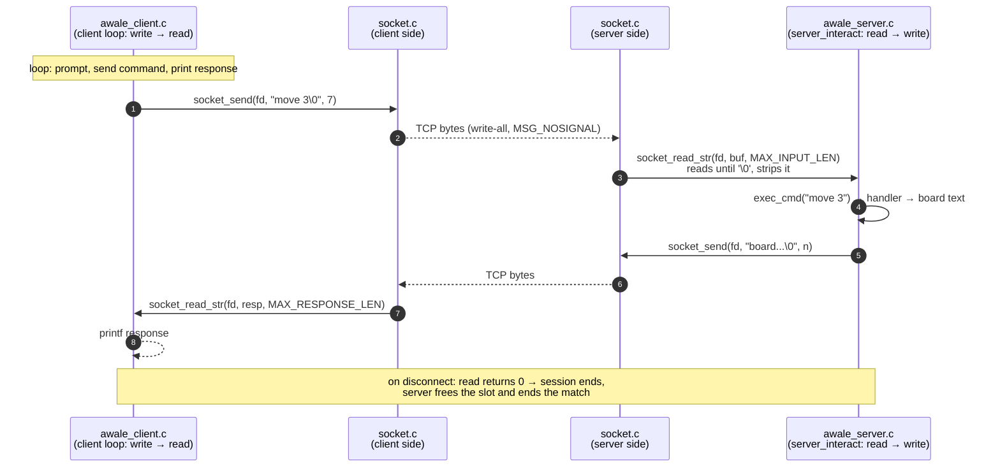
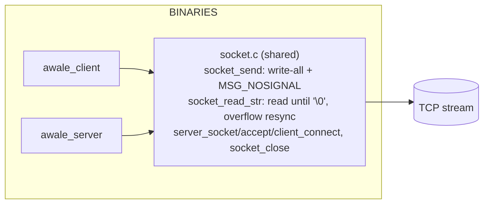

# Socket layer: client/server interaction

`socket.c` is shared by both binaries (it is in meson's `common` sources) and provides
the whole wire abstraction: `socket_send` (write-all loop, `MSG_NOSIGNAL`) and
`socket_read_str` (reads until the `'\0'` terminator, resyncs on overflow). Neither
side sees raw `send`/`read` calls.

The two interaction loops are inverse: the client writes then reads, the server reads
then writes.

